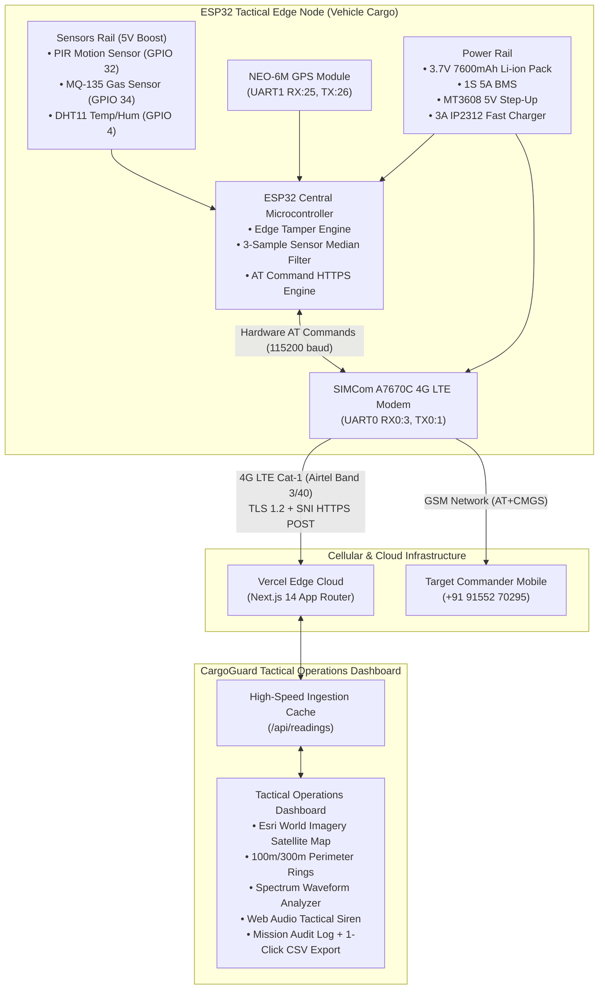

# CargoGuard: Military-Grade Cargo & Tactical Vehicle Tracking System

[](https://esp32-sentinel-monitor-187t-ankur1212s.vercel.app)
[](https://github.com/Ankur1212s/esp32-sentinel-monitor)
[](https://github.com/Ankur1212s/esp32-sentinel-monitor)
[](https://rru.ac.in)
[](LICENSE)

> **CargoGuard** is an autonomous, cellular-connected (4G LTE Cat-1) tactical transit security and telemetry system engineered for military convoys, high-value freight containers, and tactical defense vehicles. It provides 24/7 continuous perimeter tamper monitoring, hazardous chemical gas surveillance, dual-mode GPS positioning, and automated GSM SMS emergency dispatch.

🌐 **Live Tactical Dashboard:** [https://esp32-sentinel-monitor-187t-ankur1212s.vercel.app](https://esp32-sentinel-monitor-187t-ankur1212s.vercel.app)  
📍 **Default Vehicle Deployment Location:** *Rashtriya Raksha University (RRU), Lavad, Dahegam, Gandhinagar, Gujarat* (`23.154455° N, 72.885000° E`)

---

## 🏗️ System Architecture



---

## ⚡ Core Capabilities

- **Autonomous Vehicle Tracking**: Dual-positioning strategy utilizing hardware satellite GPS with automatic cellular carrier triangulation fallback.
- **Cargo Tamper & Intrusion Defense**: High-sensitivity PIR motion surveillance on GPIO32 detects unauthorized container access and instantly dispatches emergency GSM SMS alerts with live Google Maps coordinates.
- **CBRN / Atmospheric Hazard Monitoring**: Continuous parts-per-million (PPM) chemical gas sampling (MQ-135) to protect against toxic leaks, hazardous air quality, or biological contamination.
- **Thermal & Moisture Diagnostics**: High-precision ambient climate logging (DHT11) to safeguard sensitive munitions, sensitive electronics, or temperature-critical military supplies.
- **Satellite Reconnaissance Map**: Interactive Leaflet HUD utilizing Esri World Imagery, featuring 100m immediate security rings, 300m outer surveillance zones, and rapid vehicle centering.
- **Zero-Latency In-Memory Ingestion**: Sub-20ms serverless telemetry buffer on Vercel with automatic offline detection and standby coordinates.
- **1-Click Mission Audit Export**: Instant browser generation and download of complete chronological telemetry logs in CSV format for after-action reporting.

---

## 🔌 Hardware Wiring & Pinout Specification

| Component | Component Pin | ESP32 Pin / Rail | Description & Specifications |
| :--- | :--- | :--- | :--- |
| **A7670C 4G** | TXD | **RX0 (GPIO 3)** | Modem Hardware UART (115200 baud) |
| **A7670C 4G** | RXD | **TX0 (GPIO 1)** | Modem Hardware UART (115200 baud) |
| **A7670C 4G** | VBAT | **Battery (+) Direct** | 3.7V - 4.2V high-current rail (1000µF capacitor parallel) |
| **NEO-6M GPS** | TX | **GPIO 25** | Hardware UART1 RX (9600 baud) |
| **NEO-6M GPS** | RX | **GPIO 26** | Hardware UART1 TX (9600 baud) |
| **PIR Motion** | OUT | **GPIO 32** | Digital tamper signal (Internal Pulldown) |
| **DHT11** | DATA | **GPIO 4** | 1-Wire Temperature & Humidity (Internal Pullup) |
| **MQ-135 Gas** | A0 | **GPIO 34** | ADC1 Analog Input (0-3.3V calibrated) |
| **Power Step-Up**| 5V OUT | **ESP32 VIN Rail** | MT3608 5V boosted rail for sensors and MCU |
| **Ground Plane**| Common GND | **Battery (-) Star** | Unified ground star point to prevent ground loops |

---

## 📡 Cloud API Specification

### `POST /api/readings`
Ingests real-time JSON packets transmitted from the vehicle edge node via 4G LTE.

**Request Payload:**
```json
{
  "unit_id": "CARGOGUARD-01",
  "dist": 0.0,
  "temp": 27.2,
  "hum": 53.0,
  "gas": 320,
  "lat": 23.154455,
  "lon": 72.885000,
  "alert": false,
  "motion": false
}
```

**Response:**
```json
{
  "status": "success",
  "timestamp": "2026-10-18T18:01:49.037Z"
}
```

### `GET /api/readings`
Serves active vehicle coordinates, online heartbeat state (computed via a 45-second sliding timeout), and rolling telemetry history to the dashboard.

---

## 🛠️ Local Development & Deployment

### 1. Clone & Install Dependencies
```bash
git clone https://github.com/Ankur1212s/esp32-sentinel-monitor.git
cd esp32-sentinel-monitor
npm install
```

### 2. Run Local Development Server
```bash
npm run dev
```
Open [http://localhost:3000](http://localhost:3000) in your browser.

### 3. Vercel Cloud Deployment
Deploy directly to Vercel with zero server maintenance:
```bash
vercel --prod
```

---

## 📁 Repository Structure

```
esp32-sentinel-monitor/
├── app/
│   ├── api/
│   │   ├── alerts/route.ts      # Intrusion alert endpoint
│   │   └── readings/route.ts    # High-speed telemetry ingestion & standby defaults
│   ├── components/
│   │   └── TacticalMap.tsx      # Esri satellite Leaflet component with vehicle HUD
│   ├── globals.css              # Military HUD styles, tactical brackets & DEFCON strobes
│   ├── layout.tsx               # Root layout, metadata & Leaflet CSS styles
│   └── page.tsx                 # CargoGuard Tactical Operations Dashboard
├── firmware/
│   └── esp32_sentinel/
│       └── esp32_sentinel.cpp   # Complete ESP32 C++ firmware (PlatformIO / Arduino)
├── public/                      # Static brand assets and tactical markers
├── package.json                 # Next.js 14, React 18, Leaflet, Chart.js dependencies
└── README.md                    # System architecture and technical documentation
```

---

## 🎓 Academic & Institutional Credits

Developed under the **AIC Project Initiative** at **Rashtriya Raksha University (RRU)**, National Exemplar Institution for National Security and Defense Studies, Lavad, Dahegam, Gandhinagar, Gujarat.

- **Lead Engineer & Developer:** Cadet / Engineer Ankur
- **Project Domain:** Autonomous Defense Logistics, IoT Cargo Security & Embedded Cellular Telemetry
- **License:** MIT Open Source License
